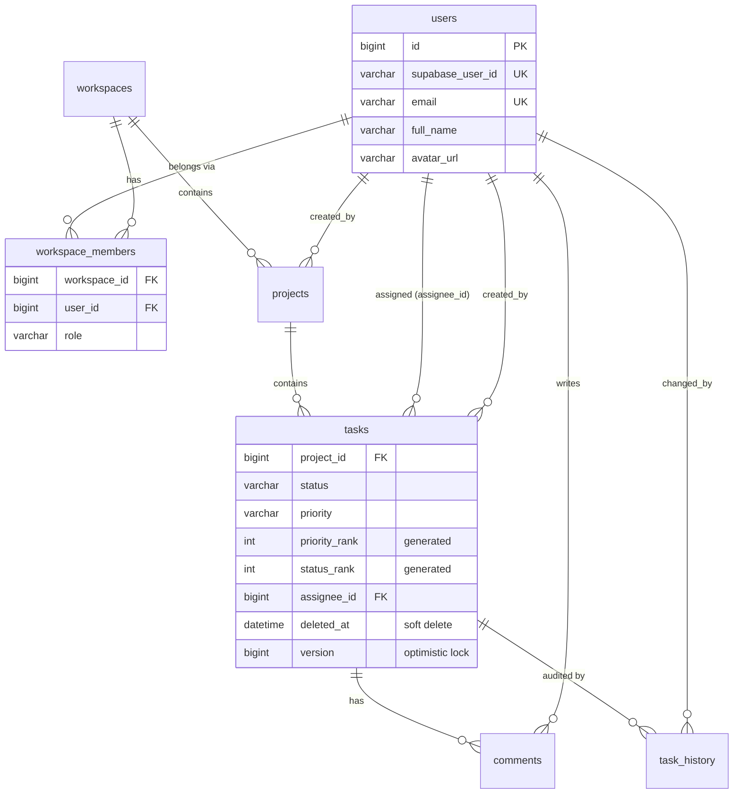

# Database design

MySQL 8, InnoDB, utf8mb4. Schema owned by Flyway (`backend/src/main/resources/db/migration`). Hibernate runs with `ddl-auto: none`.

## ER diagram

## Tables

The seven tables from the SRS. Additions are marked.

| Table | Notes |
|---|---|
| `users` | `supabase_user_id` UNIQUE links to the Supabase identity (added). `email` UNIQUE, stored lowercase. No password column |
| `workspaces` | name, description |
| `workspace_members` | UNIQUE `(workspace_id, user_id)`; CHECK role IN (OWNER, LEAD, MEMBER); FK to workspace ON DELETE CASCADE |
| `projects` | UNIQUE `(workspace_id, name)`; CHECK status; CHECK `due_date >= start_date` |
| `tasks` | CHECK status and priority; generated stored `priority_rank` and `status_rank` for meaningful sorting (added); `deleted_at` soft delete (added); `version` optimistic lock (added); nullable `assignee_id` |
| `comments` | text, author, time |
| `task_history` | append-only: field name, old/new value (text), who, when |

## Integrity decisions

- Enumerations are enforced twice: Java enums and database CHECK constraints.
- "Exactly one owner" is enforced in the service layer (MySQL has no partial unique index). Ownership transfer is out of scope, so the owner row is created once with the workspace and never changed.
- Assignee membership ("assignee must belong to the workspace") spans two tables and is enforced in the service layer inside the transaction.
- Tasks are soft-deleted so history is never orphaned. Hibernate hides them with `@SQLRestriction`.
- Cascades: deleting a workspace or project removes children. No API deletes either; this protects against manual cleanup leaving orphans.
- `users` rows are never deleted by the app.

## Indexes

Unique keys cover `users(email)`, `users(supabase_user_id)`, `workspace_members(workspace_id, user_id)`, `projects(workspace_id, name)`. V5 adds: `workspace_members(user_id)`, `projects(workspace_id, status)`, `tasks(project_id, status)`, `tasks(assignee_id, status)`, `tasks(due_date)`, `tasks(deleted_at)`, `task_history(task_id, created_at)`, `task_history(created_at)`, `comments(task_id, created_at)`. InnoDB creates foreign-key indexes automatically; verify with `SHOW INDEX` on your instance.

## Transactions

Workspace + owner membership; task + "created" history; status change + history; member removal + assignment clearing + history. All are single `@Transactional` service methods. History writes require an active transaction.

## Query patterns

Task lists use JPA Specifications with filters, an allowlisted sort and `EntityGraph` for the to-one associations; dashboard figures use `GROUP BY` aggregates; project completion counts are fetched in one batched query per page.
